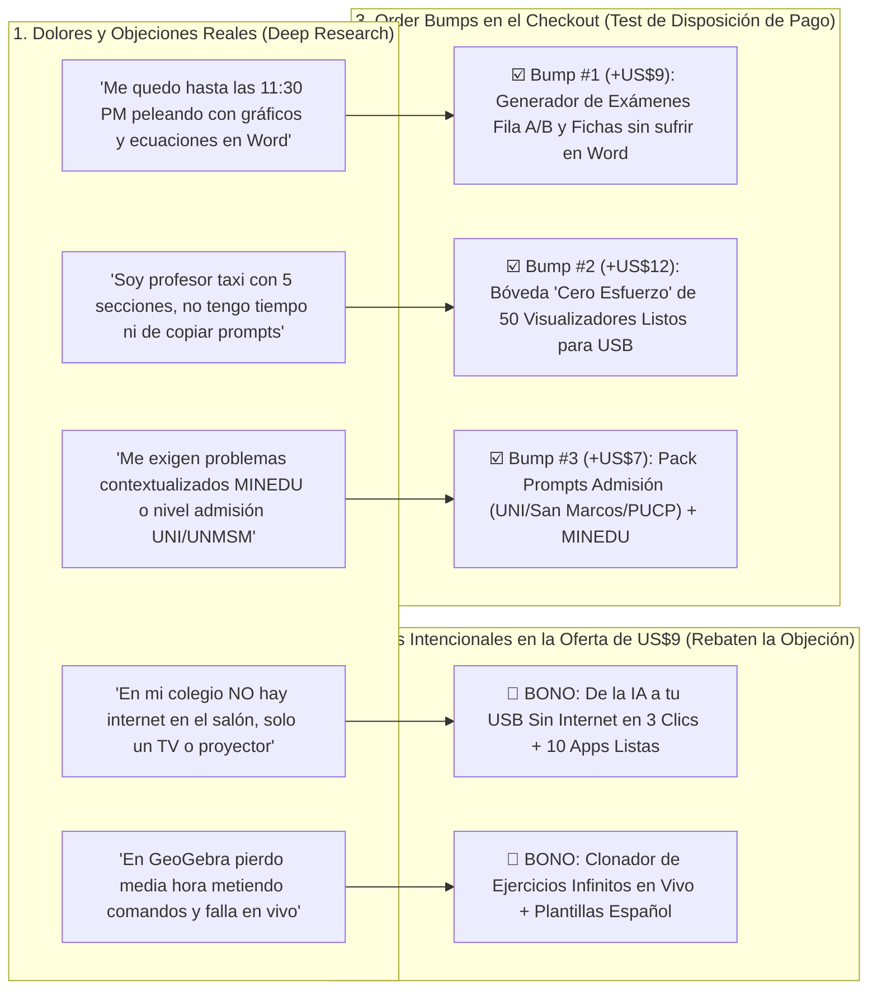

# Arquitectura Maestra Intencional: TSL + Bonos Destructores de Objeciones + 3 Order Bumps Forenses

> [!IMPORTANT]
> **Nada al azar — Todo es 100% intencional (Incluido el Primer Pliegue / Hero `#inicio`):**
> Tras cruzar el informe forense [Investigacion_Profesores_de_Matematicas.md](file:///c:/Users/cabel/Music/taller_web_cero/Investigacion_Profesores_de_Matematicas.md) con nuestra página de ventas, cada elemento desde la **Sección Principal (`#inicio`)** hasta los *Order Bumps* del checkout cumple una función quirúrgica dentro del embudo.

---

## 0. Diagnóstico y Reforma Quirúrgica de la Sección Principal (`#inicio` — Above the Fold)

### ¿Por qué la Sección Principal anterior aún se sentía débil?
En la versión previa, aunque los bloques 2 al 12 ya tenían los hallazgos del estudio forense, el **Bloque 1 (Hero `#inicio`)** todavía conservaba el titular antiguo (*«Menos tiempo escribiendo y dibujando en la pizarra...»*) y el subtítulo genérico (*«Aprende a crear aplicaciones con IA para utilizarlas durante tus clases de matemáticas...»*).
Según las **Secciones 5 y 9 de [Investigacion_Profesores_de_Matematicas.md](file:///c:/Users/cabel/Music/taller_web_cero/Investigacion_Profesores_de_Matematicas.md)**, decirle a un profesor agotado *"Aprende a crear aplicaciones con IA"* activa su escepticismo defensivo (Fase 3–4 de Sofisticación de Eugene Schwartz), porque suena a más trabajo no remunerado, teoría o programación.

### Cómo aplica ahora la Sección Principal (`#inicio`) la Regla de Oro de Ultra-Conversión (Ogilvy × Brunson × Hormozi):
En lugar de saturar el primer pliegue con párrafos extensos, estructuramos el **Hero (`#inicio`)** en **2 columnas limpias y filudas** (lectura en menos de 4 segundos + impacto visual inmediato):

1. **Columna Izquierda (Copy Filudo y Puntual):**
   * **Pre-Titular (Enfoque en Secundaria sin dañar el alcance del Graficador):**
     > *«PARA PROFESORES DE MATEMÁTICAS · ESPECIALMENTE SI ENSEÑAS EN SECUNDARIA»*
   * **Titular `H1` Corto y Directo al Hueso (21 palabras):**
     > **Deja de perder media hora dibujando en la pizarra mientras tu salón se distrae. Lleva «Pizarras Vivas en 2D y 3D» en tu USB 100% sin internet.**
   * **Subtítulo Conciso (2 oraciones):**
     > *«Sin saber programar ni pelear con comandos de GeoGebra en plena clase. Copias una plantilla en español, la pegas en la IA gratuita y en 60 segundos descargas un visualizador interactivo para el televisor o proyector de tu aula. **Menos tiempo escribiendo y dibujando en la pizarra. Más tiempo guiando el aprendizaje.**»*
   * **3 Viñetas Rápidas (`✓`) + Botón CTA (`US$9`) + Botón Secundario (`Probar graficador en vivo ↓`):**
     * `✓ Explicas de frente al aula sin desgastar tu garganta ni tu hombro en 5 secciones`
     * `✓ Abre 100% sin Wi-Fi desde tu USB (incluye 10 apps listas para mañana a las 8:00 AM)`
     * `✓ Ideal para secundaria y adaptable hasta nivel preuniversitario y cálculo`
2. **Columna Derecha (Imagen Protagonista en el Primer Pliegue — *Show, Don't Tell*):**
   * Presenta en el propio Hero la imagen hiperrealista [`/metodo/dolor-pizarra-vs-clase-viva.webp`](file:///c:/Users/cabel/Music/taller_web_cero/public/metodo/dolor-pizarra-vs-clase-viva.webp) con `fetchPriority="high"`, contrastando visualmente en 1 segundo el **Antes** (*2 min de espaldas trazando con plumón = salón en el celular*) vs. **Ahora** (*Giras sólidos 3D y funciones con un clic mirando siempre a tu clase*).
3. **Sección 1.5 (`#demostracion`) Separada Debajo del Hero:**
   * Mantiene el graficador interactivo [`MathStudio`](file:///c:/Users/cabel/Music/taller_web_cero/src/components/MathStudio.tsx) con todo su poder y sus **3 niveles (Secundaria, Preuniversitario y Universidad)** en su propio bloque dedicado para no recargar el primer pliegue.

---

## 1. Mapa de Intencionalidad: Dolor Forense → Bono / Entregable → Order Bump

---

## 2. Actualizaciones Intencionales Bloque por Bloque en [`src/App.tsx`](file:///c:/Users/cabel/Music/taller_web_cero/src/App.tsx)

### A. Inyección de la «Voz Literal del Cliente» (Sala de Profesores en Perú y LatAm)
En el **Bloque 1 (Hero `#inicio`)**, en el **Bloque 2 (El Lead «De Profesor a Profesor»)** y en el **Bloque 3 (Matriz Comparativa)** incorporamos los síntomas exactos detectados por la investigación:
1. **La tragedia de los 2 minutos de espaldas y la raya del poliedro:**
   > *«Pasarte media hora dibujando un poliedro con tres colores de plumón para que al final te pregunten: "¿Profe, esa raya punteada está adentro o afuera?", mientras la mitad del salón ya sacó el celular a tus espaldas.»*
2. **El dolor de las 11:30 PM, el síndrome del domingo a las 5:00 PM y el "Profesor Taxi":**
   > *«Dictar en 5 secciones distintas repitiendo la misma gráfica 15 veces por semana con el hombro y la garganta destrozados, para luego llegar a casa a trabajar gratis hasta medianoche armando separatas.»*
3. **La diferencia económica en Clases Particulares (De S/ 25/h a S/ 60–80/h):**
   > *«Dejar de competir por precio contra universitarios que cobran S/ 20 la hora y justificar tarifas de S/ 60 a S/ 80+ por hora mostrando a los padres simuladores interactivos que destraban a sus hijos en una sola sesión.»*

---

### B. Bloque Intencional: «Por qué fallaron las soluciones que probaste antes» (Nivel 3–4 de Sofisticación de Eugene Schwartz)
Rebatimos con empatía por qué el profesor tiene razón al desconfiar de lo que ya probó:
* **❌ Diapositivas de PowerPoint / Canva:** Son imágenes muertas en 2D; si un alumno pregunta *«¿qué pasa si el coeficiente es negativo?»*, la diapositiva no se mueve y terminas escribiendo encima con plumón.
* **❌ GeoGebra manual en vivo:** Configurar comandos frente a 40 adolescentes inquietos consume media clase; te equivocas en un paréntesis y perdiste el salón.
* **❌ Videos de YouTube de otros profesores:** Te quitan autoridad escénica frente al grupo y no puedes cambiar los datos del video para resolver el problema de tu pizarra.
* **✅ Nuestro Mecanismo Único (*Método Pizarra Viva IA™ por Inyección de Plantillas*):** Quien sabe mandar un WhatsApp y copiar y pegar en Word ya tiene el 100% de la habilidad técnica necesaria. Copias la plantilla en español, la pegas en la IA gratuita y en 60 segundos descargas un **archivo único para tu USB que funciona 100% SIN INTERNET** en cualquier televisor o proyector.

---

### C. Rediseño Intencional del *Grand Slam Offer Stack* (`Valor Total: US$197` → `Hoy: US$9`)
En el **Bloque 10 (`#inscripcion`)**, presentamos los **5 Entregables y Bonos Intencionales** del estudio forense, donde cada uno mata una objeción específica:

| Entregable / Bono Intencional (Incluido hoy por US$9) | Objeción que Destruye | Valor Anclado |
| :--- | :--- | :---: |
| **1. El Generador Maestro «Pizarra Viva 3D» (Geometría del Espacio y Sólidos)** | *«Mis alumnos no ven la perspectiva en 2D y me demoro media hora trazando poliedros.»* | `US$47` |
| **2. El Laboratorio Dinámico de Funciones, Trigonometría y Cálculo** | *«Me desgasto el hombro dibujando y borrando la misma gráfica 15 veces por semana.»* | `US$47` |
| **3. El Motor «Paso a Paso» Anti-Ansiedad Matemática (Álgebra y Aritmética)** | *«El alumno ve la pizarra llena de ecuaciones, se bloquea y dice 'Sí entendí' por vergüenza.»* | `US$37` |
| **🎁 BONO INTENCIONAL #1: El Clonador de Ejercicios Infinitos en Vivo (Botón «Nuevo Reto»)** | *«Pierdo horas inventando ejercicios cuyos datos salgan exactos para hacerlos practicar.»* | `US$27` |
| **🎁 BONO INTENCIONAL #2: Guía «De la IA a tu USB Sin Internet en 3 Clics» + Bóveda de 10 Apps Listas para Mañana a las 8:00 AM** | *«En mi colegio NO hay internet en las aulas y necesito algo que funcione mañana mismo.»* | `US$39` |
| **VALOR TOTAL DEL KIT COMPLETO:** | | ~~`US$197`~~ |
| **TU ÚNICO PAGO HOY (Lo que cuestan 2 cajas de plumones o 1 hora de clase particular):** | | **`US$9`** |

---

### D. Los 3 *Order Bumps* Intencionales en el Checkout (Validación de Demanda en Vivo)
Dentro de la tarjeta de pago en `#inscripcion`, añadimos el selector interactivo de **Complementos Opcionales de 1 Clic (*Order Bumps*)** para cumplir dos metas simultáneas:
1. **Elevar el Ticket Promedio (AOV) de US$9 a US$16–US$37** para financiar Facebook Ads.
2. **Medir intencionalmente qué dolor complementario tiene mayor disposición de pago:**

* **☑️ Order Bump #1 (`+US$9`): Generador Automático de Exámenes Fila A/B, Prácticas y Solucionarios Listos para Imprimir (Sin Sufrir en Word)**
  * *Qué mide:* Disposición a pagar por eliminar el trabajo nocturno de tipear ecuaciones y gráficos en Word.
* **☑️ Order Bump #2 (`+US$12`): Bóveda «Cero Esfuerzo» de 50 Visualizadores Matemáticos Ya Creados para tu USB (Secundaria + Pre)**
  * *Qué mide:* Disposición a pagar por paquetes *Done-For-You* (hechos al 100%) para profesores sin nada de tiempo.
* **☑️ Order Bump #3 (`+US$7`): Pack de Prompts «Problemas Tipo Admisión (UNI / San Marcos / PUCP)» y Situaciones Significativas MINEDU**
  * *Qué mide:* Disposición a pagar por rigor preuniversitario vs. cumplimiento burocrático de competencias del MINEDU.

---

### E. Sección de FAQ Intencional (Las 7 Objeciones Forenses del Estudio)
Las preguntas frecuentes rebaten palabra por palabra las objeciones literales descubiertas en la investigación:
1. **«En mi colegio no hay internet en los salones, apenas un proyector o TV. ¿Igual funciona?»** → Explicación del archivo único `.html` en memoria USB 100% offline.
2. **«Ya probé GeoGebra y cursos de TICs y perdía demasiado tiempo metiendo comandos. ¿Por qué esto es distinto?»** → Contraste con las plantillas en español de copiar y pegar.
3. **«No soy programador y tengo más de 45 años. ¿Necesito saber código o pagar una IA cara de US$20/mes?»** → Analogía del WhatsApp/Word + funciona con IA 100% gratuita.
4. **«¿Por qué cuesta solo US$9 (S/ 33)? ¿Hay cobros mensuales ocultos?»** → Anclaje transparente a dos cajas de plumones o una hora de clase particular.
5. **«¿Cómo recupero estos US$9 en mi primera semana dando clases particulares o en mi colegio?»** → Ruta de S/ 25/h a S/ 60–80/h y prestigio en observaciones de aula.
